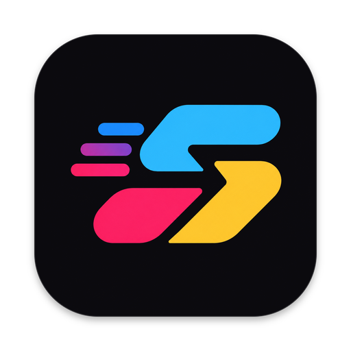

<p align="center">
  
</p>

<h1 align="center">Slackless</h1>

<p align="center">A fast, lightweight native Slack client for macOS, written in Rust with GPUI — with a permanent local archive and headless CLI.</p>

<p align="center"><sub>Linux and Windows support may come in the future.</sub></p>

<p align="center">
  
</p>

## Highlights

- **Native Rust + GPUI performance** — `0.0%` idle CPU, **3.5×–5.9× lower RAM** and **1.5×–3× lower CPU** than Electron Slack across idle and live video/screen-share huddles (see [Performance Benchmarks](#performance-benchmarks)), instant cold boot with persisted bot profiles and channel counts.
- **Permanent local archive & offline FTS5 search** — Every message, edit, and deletion observed is stored permanently in a zlib-compressed SQLite archive (`~194 MiB` for 148k messages), with instant offline search (`in:`, `from:`, `has:`, `before:`, `after:`) that outlives Slack's 90-day retention wall.
- **Native Amazon Chime Huddles** — Pluggable hardware media backend (`ScreenCaptureKit` + `AVFoundation` + `VideoToolbox` H.264 High/CABAC + `VTPixelTransferSession` GPU scaling + runtime-gated HW AV1 decode on M3+ + zero-copy `420f` Metal surfaces + parallel `SCScreenshotManager` thumbnails + async Apple Vision ANE / 4× Metal bokeh blur + CoreAudio `VoiceProcessingIO` hardware AEC/NS/AGC on macOS, with portable `cpal`/`sonora`/software fallback for future Linux/Windows ports), parallel per-track remote video decoders, Opus FEC/DTX & CoreAudio hot-plug, macOS 14.2+ CoreAudio system audio tap, smooth Bézier drawing, live captions, and floating reactions.
- **Daily-driver Slack parity** — Multi-workspace switcher, Slack Connect, full Block Kit, Canvases, Lists (CSV/JSON import & export, item comment threads with `@mention` autocomplete), dual-track H.264/AAC Clips, VIP breakthrough & Focus mode, opt-in macOS Calendar status sync, native macOS notifications, menu bar item, and `slack://` deep links.
- **Headless CLI & AI agent skill** — Scriptable `slackless` binary sharing the same local archive and macOS Keychain session, emitting single-line `--json` for automation and agents ([`skill/SKILL.md`](skill/SKILL.md)).

## Performance Benchmarks

Measured side-by-side on Apple M4 Pro (macOS, total process tree — 1 native process for Slackless vs. 7 Electron processes for Official Slack `4.49.89`, live huddle in the same channel, 1080p screen share):

| State                                      |                      Slackless (1 proc) |               Official Slack (7 procs) | Delta                                   |
| ------------------------------------------ | --------------------------------------: | -------------------------------------: | --------------------------------------- |
| **Idle**                                   |       **`0.0%` CPU** · **`275–280 MB`** |   `1.0%` CPU (max `3.2%`) · `1,622 MB` | **0% idle CPU · 5.8× less RAM**         |
| **Audio huddle (unmuted)**                 |    **`9–12.6%` CPU** · **`297–300 MB`** | `25.4%` CPU (max `30.2%`) · `1,094 MB` | **~2.0×–2.5× less CPU · 3.7× less RAM** |
| **Audio huddle (muted)**                   |  **`7.2–10.1%` CPU** · **`296–299 MB`** | `20.9%` CPU (max `23.3%`) · `1,113 MB` | **~2.1×–2.9× less CPU · 3.7× less RAM** |
| **Screen share only (1080p)**              | **`17.2–19.4%` CPU** · **`308–320 MB`** | `57.2%` CPU (max `80.4%`) · `1,122 MB` | **~3.0×–3.3× less CPU · 3.6× less RAM** |
| **Screen share + video**                   |          **`28.0%` CPU** · **`321 MB`** | `62.8%` CPU (max `70.3%`) · `1,211 MB` | **~2.2× less CPU · 3.8× less RAM**      |
| **Screen share + video + background blur** |       **`34–40.6%` CPU** · **`338 MB`** | `63.5%` CPU (max `71.3%`) · `1,308 MB` | **~1.6×–1.9× less CPU · 3.9× less RAM** |

Reproducible total-system measurements (exact cumulative CPU time deltas across both app PIDs and macOS system daemons `WindowServer`, `coreaudiod`, `VTEncoderXPCService`, `VTDecoderXPCService`, `aned`) can be run via `scripts/bench-huddle.py`.

## Install (macOS App + CLI)

```sh
nix develop   # or: direnv allow
scripts/bundle-macos.sh --install --install-cli
```

This builds release binaries and installs:

- `~/Applications/Slackless.app` (with `slack://` deep-link handling and native notifications)
- `~/.local/bin/slackless` (headless CLI)

For quick local runs or an offline demo with bundled sample data:

```sh
cargo run --release -p slackless-gui              # live signed-in workspace
SLACKLESS_FIXTURES=1 cargo run -p slackless-gui   # offline sample workspace
```

The first live launch opens Slack's sign-in window; subsequent launches reuse the macOS Keychain session.

## CLI Quickstart

```sh
slackless unread --json                           # live unread channels, DMs & mentions
slackless search "deploy in:#eng" --json          # instant offline FTS5 search
slackless read "#eng" --limit 20 --json           # read recent messages offline
slackless send "#eng" "deploy is green" --json    # post a message
slackless status set "In a meeting" --emoji spiral_calendar_pad --json
slackless backfill "#eng" --pages 10 --json       # backfill older history into SQLite
slackless stats --breakdown && slackless vacuum   # inspect & compact local archive
```

See [`skill/SKILL.md`](skill/SKILL.md) for the full command reference and `--json` schemas.

## Workspace Layout

| Path                                 | Role                                                                                        |
| ------------------------------------ | ------------------------------------------------------------------------------------------- |
| `apps/slackless-gui`                 | Native GPUI macOS desktop client                                                            |
| `apps/slackless-cli`                 | Headless CLI (`search`, `read`, `send`, `watch`, `huddle`, `canvas`, `list`, `backfill`, …) |
| `crates/slackless-core`              | Event reducer, background backfill, multi-workspace state, huddle controller                |
| `crates/slackless-store`             | Durable zlib-compressed SQLite + FTS5 archive & revision log                                |
| `crates/slackless-huddle`            | Pure-Rust Amazon Chime WebRTC audio/video/screen-share & clip recorder                      |
| `crates/slackless-api` / `rtm`       | Slack private web-client REST & realtime WebSocket clients                                  |
| `crates/slackless-auth` / `platform` | Embedded WebKit sign-in, Keychain storage, macOS notifications/dock/menu bar                |

Feature tracking lives in [`docs/feature-parity.md`](docs/feature-parity.md) (`509` shipped / `0` partial).

## Data & Privacy

- **Credentials** are stored in the macOS Keychain (never written to plaintext config files).
- **Local archive** lives at `~/Library/Application Support/slackless/<TEAM_ID>.sqlite`.
- Slackless talks directly to Slack — no third-party relay, proxy, or telemetry.
