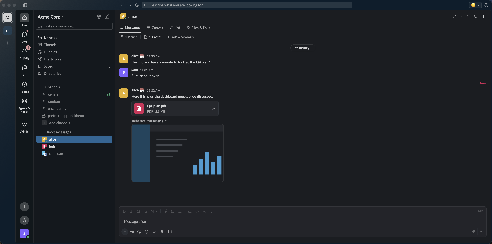

<p align="center">
  
</p>

<h1 align="center">Slackless</h1>

<p align="center">A fast, lightweight native Slack client for macOS, written in Rust with GPUI — with a permanent local archive and headless CLI.</p>

<p align="center"><sub>Linux and Windows support may come in the future.</sub></p>

<p align="center">
  
</p>

## Highlights

- **Native Rust + GPUI performance** — ~2× lower RSS than Electron Slack (`~277 MB` vs `~551 MB`), `0.0%` idle CPU, instant cold boot with persisted bot profiles and channel counts.
- **Permanent local archive & offline FTS5 search** — Every message, edit, and deletion observed is stored permanently in a zlib-compressed SQLite archive (`~194 MiB` for 148k messages), with instant offline search (`in:`, `from:`, `has:`, `before:`, `after:`) that outlives Slack's 90-day retention wall.
- **Native Amazon Chime Huddles** — Pure-Rust WebRTC audio (Sonora AEC3/NS/AGC, Opus PLC packet-loss concealment, automatic AirPods/default-device hot-swap), camera with portrait blur, screen sharing (with macOS 14.2+ CoreAudio system audio tap), live captions, drawing, floating reactions, and interactive huddle cards.
- **Daily-driver Slack parity** — Multi-workspace switcher, Slack Connect, full Block Kit, Canvases, Lists (CSV/JSON import & export, item comment threads with `@mention` autocomplete), dual-track H.264/AAC Clips, VIP breakthrough & Focus mode, opt-in macOS Calendar status sync, native macOS notifications, menu bar item, and `slack://` deep links.
- **Headless CLI & AI agent skill** — Scriptable `slackless` binary sharing the same local archive and macOS Keychain session, emitting single-line `--json` for automation and agents ([`skill/SKILL.md`](skill/SKILL.md)).

## Install (macOS App + CLI)

```sh
nix develop   # or: direnv allow
scripts/bundle-macos.sh --install --install-cli
```

This builds release binaries and installs:

- `~/Applications/Slackless.app` (with `slack://` deep-link handling and native notifications)
- `~/.local/bin/slackless` (headless CLI)

For quick local runs or an offline demo with bundled sample data:

```sh
cargo run --release -p slackless-gui              # live signed-in workspace
SLACKLESS_FIXTURES=1 cargo run -p slackless-gui   # offline sample workspace
```

The first live launch opens Slack's sign-in window; subsequent launches reuse the macOS Keychain session.

## CLI Quickstart

```sh
slackless unread --json                           # live unread channels, DMs & mentions
slackless search "deploy in:#eng" --json          # instant offline FTS5 search
slackless read "#eng" --limit 20 --json           # read recent messages offline
slackless send "#eng" "deploy is green" --json    # post a message
slackless status set "In a meeting" --emoji spiral_calendar_pad --json
slackless backfill "#eng" --pages 10 --json       # backfill older history into SQLite
slackless stats --breakdown && slackless vacuum   # inspect & compact local archive
```

See [`skill/SKILL.md`](skill/SKILL.md) for the full command reference and `--json` schemas.

## Workspace Layout

| Path                                 | Role                                                                                        |
| ------------------------------------ | ------------------------------------------------------------------------------------------- |
| `apps/slackless-gui`                 | Native GPUI macOS desktop client                                                            |
| `apps/slackless-cli`                 | Headless CLI (`search`, `read`, `send`, `watch`, `huddle`, `canvas`, `list`, `backfill`, …) |
| `crates/slackless-core`              | Event reducer, background backfill, multi-workspace state, huddle controller                |
| `crates/slackless-store`             | Durable zlib-compressed SQLite + FTS5 archive & revision log                                |
| `crates/slackless-huddle`            | Pure-Rust Amazon Chime WebRTC audio/video/screen-share & clip recorder                      |
| `crates/slackless-api` / `rtm`       | Slack private web-client REST & realtime WebSocket clients                                  |
| `crates/slackless-auth` / `platform` | Embedded WebKit sign-in, Keychain storage, macOS notifications/dock/menu bar                |

Feature tracking lives in [`docs/feature-parity.md`](docs/feature-parity.md) (`509` shipped / `0` partial).

## Data & Privacy

- **Credentials** are stored in the macOS Keychain (never written to plaintext config files).
- **Local archive** lives at `~/Library/Application Support/slackless/<TEAM_ID>.sqlite`.
- Slackless talks directly to Slack — no third-party relay, proxy, or telemetry.
